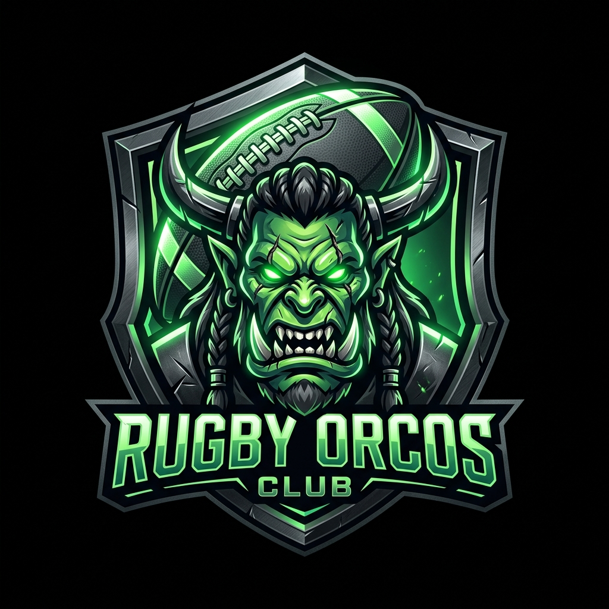

# RUGBY ORCOS NEGROS — Reino Manager v5.0

<p align="center">
  
</p>

Aplicacion Web Progresiva (PWA) para la gestion integral del club de rugby **Orcos Negros**. Arquitectura **Supabase-First** — PostgreSQL como unica fuente de verdad. Datos compartidos en tiempo real entre 80+ miembros. Tematica RPG de fantasia epica con roles, torneos, entrenamientos, finanzas y mas.

---

## Stack Tecnologico

| Categoria | Tecnologia |
|-----------|-----------|
| Frontend | React 18 + Vite 4 |
| Backend | **Supabase** (PostgreSQL, Auth, API, RLS) |
| Auth | Email/Password + Username para Guerreros |
| Mobile | Capacitor (Android APK) + PWA (iOS Safari) |
| IA | Groq · DeepSeek · Gemini (multi-provider con fallback) |
| Estilos | CSS puro con Custom Properties (glassmorphism + neon) |
| PWA | vite-plugin-pwa (16 assets precacheados + runtime cache) |
| Deploy | Vercel (frontend) + Supabase Cloud (backend) |

---

## REGLA DE ORO — Arquitectura Supabase-First

**PostgreSQL (Supabase) es la unica fuente de verdad.** Toda escritura va directo a la BD via `upsert()`. Toda lectura viene de `fetchAll()`. localStorage es solo cache de lectura.

| Operacion | Destino |
|---|---|
| Crear evento/partido/finanza/jugador | `supabase.from('tabla').upsert()` |
| Leer datos al cargar | `useSyncPull → fetchAll() → setState` |
| Recargar pagina | `fetchAll()` — los datos vienen de Supabase |
| Otro usuario abre la app | Ve los mismos datos (segun permisos RLS) |

**Sin backup, sin merge, sin re-push.** Si Supabase no responde, `syncStatus='offline'`.

---

## Estructura del Proyecto

```
Rugby Orcos/
├── src/
│   ├── main.jsx                 # Entry point
│   ├── App.jsx                  # Header, tabs, navegacion, admin panel
│   ├── index.css                # Design system (neon, glassmorphism, variables)
│   ├── supabaseClient.js        # Cliente Supabase
│   ├── context/
│   │   ├── AuthContext.jsx      # Autenticacion (login, signup, perfil, roles)
│   │   ├── ClubContext.jsx      # Estado global, CRUD, permisos, sync Supabase
│   │   └── ToastContext.jsx     # Notificaciones toast
│   ├── components/
│   │   ├── Login.jsx            # Login unificado (email/username + password)
│   │   ├── Dashboard.jsx        # Panel principal (metricas, HIA, Sin-Bin, wellness)
│   │   ├── Roster.jsx           # CRUD jugadores, atributos RPG, insignias, credenciales
│   │   ├── CanchaTactica.jsx    # Pizarra con 11 formaciones + drag-and-drop
│   │   ├── Tribunal.jsx         # Asistencia, infracciones, rankings
│   │   ├── Calendario.jsx       # Agenda/Fixture/Proximos/Rivales (QuickTrainingPanel)
│   │   ├── Finanzas.jsx         # Caja chica, membresias, inventario (AddInventoryForm)
│   │   ├── TrainingHub.jsx      # Plan inteligente + IA Personal Trainer multi-proveedor
│   │   ├── AIChat.jsx           # Chat tactico multi-proveedor IA
│   │   ├── AwardsHall.jsx       # Salon de la Fama (43 premios + certificados)
│   │   ├── MakgoraHub.jsx       # Torneo Mak'Gora (equipos, fixture, standings, prestamos)
│   │   ├── Invitaciones.jsx     # Dashboard de invitaciones a rivales
│   │   ├── MatchInvitation.jsx  # Pagina publica de invitacion (sin login)
│   │   ├── PlayerDashboard.jsx  # Vista del Guerrero (4 tabs: Perfil, Agenda, Entreno, Bienestar)
│   │   ├── UserManagement.jsx   # Admin de usuarios, roles y reset password
│   │   ├── Settings.jsx         # Configuracion IA, tema claro/oscuro, cuenta
│   │   ├── Rivales.jsx          # Gestion de equipos rivales
│   │   ├── AuthCallback.jsx     # Callback de autenticacion
│   │   ├── ErrorBoundary.jsx    # Captura de errores React
│   │   ├── Messages.jsx          # Mensajeria interna con attachments, reacciones, busqueda
│   │   ├── AnnouncementModal.jsx # Anuncios tipo popup
│   │   ├── AvatarPicker.jsx     # 40 SVGs mitologicos + subir foto
│   │   ├── PlayerPhoto.jsx      # Avatar/foto con fallback a iniciales
│   │   ├── WorkoutLogger.jsx    # Logging de ejercicios completados
│   │   ├── PlayerProgressTab.jsx# Graficas de progreso gym
│   │   ├── PlayerCompare.jsx    # Comparativa lado a lado de 2 jugadores
│   │   ├── Toast.jsx            # Componente toast
│   │   ├── Dashboard/
│   │   │   ├── ActivityFeed.jsx # Actividad reciente del club
│   │   │   └── MiniRanking.jsx  # Top 3 asistencia/MVP/tries
│   │   ├── Calendario/AgendaTab/
│   │   │   ├── MonthlyView.jsx  # Calendario en vista mensual
│   │   │   └── EventRsvp.jsx    # Confirmacion de asistencia (going/maybe/not_going)
│   │   ├── TrainingHub/
│   │   │   ├── TeamOverview.jsx # Vista equipo con alertas de carga
│   │   │   └── ExerciseForm.jsx # Creacion de ejercicios personalizados
│   │   └── MakgoraHub/
│   │       └── ChampionsHistory.jsx # Salón de campeones historico
│   ├── data/
│   │   ├── supabaseApi.js       # Capa API Supabase + conversor de datos
│   │   ├── exerciseLibrary.js   # 44 ejercicios de rugby
│   │   └── faultExerciseMap.js  # Mapa fallos → ejercicios correctivos
│   ├── __tests__/                # 53 archivos, 546 tests
│   └── engine/
│       ├── assignmentEngine.js  # Motor de reglas para planes de entrenamiento
│       ├── aiProvider.js        # Router multi-proveedor IA + generateTrainingPlan
│       ├── promptBuilder.js     # buildAITrainingContext (14 fuentes de datos)
│       ├── aiCache.js           # Cache LRU en localStorage
│       ├── aiConfig.js          # Configuracion de proveedores IA
│       ├── contentFilter.js     # Filtro de contenido rugby
│       ├── matchAnalyzer.js     # Analisis de partidos con IA
│       ├── attributeCalculator.js# Calculo de atributos RPG desde datos fisicos
│       ├── overtrainingDetector.js# Deteccion temprana de sobreentrenamiento
│       ├── planNormalizer.js    # Normalizador de planes IA → engine
│       ├── trainingPlanService.js# Servicio de persistencia de planes
│       └── providers/           # Groq, DeepSeek, Gemini, OpenRouter
├── supabase/migrations/
│   ├── 00_reset_db.sql
│   ├── 01_schema_v4.sql         # 27 tablas + RLS + funciones
│   ├── 02_fix_user_profiles_rls.sql
│   ├── 03_admin_reset_staff_password.sql
│   ├── 04_match_invitations.sql
│   ├── 05_messages.sql
│   ├── 06_enhance_invitations.sql
│   ├── 07_custom_tactics.sql
│   ├── 08_team_members_and_normalize.sql
│   ├── 09_fix_makgora_dupes.sql
│   ├── 10_push_tokens.sql
│   ├── 11_push_trigger.sql
│   ├── 12_unique_constraint_name_birth.sql
│   ├── 13_add_payment_date_to_player_payments.sql
│   ├── 14_finances_rls.sql
│   ├── 15_fundraising.sql               # Fundraising: campañas, asignaciones, tickets, pagos
│   ├── 16_club_config.sql               # Config por equipo (mensualidad_base)
│   ├── 17_campaign_prizes.sql           # Premios JSONB en campañas
│   ├── 18_fundraising_rls.sql           # RLS policies + get_user_tier()
│   ├── 19_fix_player_credentials.sql    # Fix inicial de credenciales
│   ├── 20_player_avatars.sql            # avatar_id + photo_url + storage
│   ├── 21-23_fix_username_generation.sql# Fixes de tipo VARCHAR vs TEXT
│   ├── 24_final_credential_fix.sql      # IF EXISTS UPDATE ELSE INSERT
│   ├── 25_exercise_catalog.sql          # Catálogo de 45+ ejercicios
│   ├── 26_gym_history.sql              # Historial de fuerza (squat/bench/deadlift)
│   ├── 29_security_audit_fixes.sql     # RLS, UNIQUE wellness, search_path
│   ├── 30_training_plans.sql           # Planes de entrenamiento persistidos
│   ├── 31_fix_child_table_rls.sql      # RLS en tablas hijas (wellness, HIA, etc)
│   ├── 32_agenda_enhancements.sql      # notes, end_date, event_rsvp
│   └── 33_event_scope.sql              # scope_type + scope_value (visibilidad)
├── android/                     # Proyecto Android Capacitor
├── vercel.json                  # Config SPA fallback para Vercel
└── .env                         # Variables de entorno (NO COMMITEAR)
```

---

## Roles RPG — Jerarquia del Reino

| Tier | Rol Sistema | Rol RPG | Icono | Permisos |
|:----:|------------|---------|:-----:|----------|
| 0 | Desarrollador | Arquitecto del Reino | 🏰 | Todo el sistema |
| 1 | Presidente | Senor de la Guerra | ⚔️ | Todos los clubes, crear usuarios |
| 2 | Promotor | Comandante de Horda | 🛡️ | Su club completo |
| 3 | Entrenador | Maestro de Armas | 🏋️ | Entrenamientos, roster, tactica |
| 3 | Tesorero | Guardian del Botin | 💰 | Finanzas, membresias |
| 3 | Arbitro | Juez del Coliseo | ⚖️ | Tribunal, disciplina |
| 4 | Jugador | Guerrero | 👹 | Solo su perfil personal |

---

## Flujo de Login

### Staff (Arquitecto, Senor, Comandante, Maestro, Guardian, Juez)
- Ingresa su **email** + contrasena → Supabase Auth → accede al panel completo segun permisos

### Guerrero (Jugador)
- Ingresa su **nombre de usuario** (ej: `freyder.andres`) + contrasena
- La app busca el username en `players` por username, nickname, apodo o nombre completo
- Obtiene su email interno → login → PlayerDashboard con 4 tabs
- Si el perfil no existe, se muestra vista "Sin rango en el Reino" con instrucciones

### Fundar Reino (primer uso / staff nuevo)
- Admin > Miembros > crear usuario con email + password + rol

---

## Modulos

### Dashboard
Metricas del squad, protocolo HIA (conmociones), temporizador Sin-Bin, wellness check-in, eventos, partidos recientes.

### Roster
CRUD de jugadores con atributos RPG (Fuerza, Velocidad, Resistencia, Tecnica). Historial fisico SVG. Lesiones 4 fases. Gimnasio 1RM. Insignias automaticas. **Forjar Credenciales** (genera username + password). **Restablecer Contrasena** de jugador. **Asignacion a equipo Mak'Gora** desde ficha de edicion.

### Pizarra Tactica
11 formaciones, drag-and-drop, asignacion de jugadores, banco de suplentes, orientacion H/V, 3 tamanos.

### Tribunal Disciplinario
Asistencia con penitencias (burpees, conos). Infracciones. Rankings: Honor, MVPs, Tries, Tackles.

### Salon de la Fama
**43 premios automaticos** basados en estadisticas (15 de Honor + 28 de la Taberna). Certificados HTML imprimibles.

### Mak'Gora
Torneo interno con 6 equipos. Crear torneos, fixture round-robin, registrar resultados, tabla de posiciones (puntos bonus). Historial de campeones. **Prestamos de jugadores** entre equipos (solicitar, aprobar, devolver). Badge en Roster.

### Invitaciones
Dashboard centralizado de invitaciones a equipos rivales. Genera links unicos por partido, los rivales registran sus jugadores sin login. Contador en vivo, respuesta aceptar/rechazar, GuestRoster visible en proximos partidos y Match Center. Badge de invitaciones activas en gestion de rivales.

### Agenda (Grupo CLUB > Calendario)
Recurrencia personalizada (dias de la semana x N semanas con vista previa). Panel de **Entreno Rapido** (crear entrenos en 2 clicks con memoria de ultima hora/lugar). Anti-duplicado (misma fecha+hora+equipo). WhatsApp formatter con mapa. Vista semanal. Editar/borrar cualquier evento. Los eventos se guardan en Supabase y son visibles para todos los miembros de la division.

### PlayerDashboard (Guerrero, tier 4)
El Guerrero accede a un dashboard con **4 tabs**: 🛡️ Mi Perfil (atributos RPG, insignias, membresia), 📅 Agenda (proximos entrenos y partidos del equipo — solo lectura), 💪 Entreno (plan generado por IA con ejercicios campo/gym/recuperacion — solo lectura), 🧘 Bienestar (wellness check-in diario con estrellas de sueno/dolor/estres). Sin acceso a crear/editar/borrar datos del club.

### Finanzas
Caja chica, membresias con abonos parciales y cobro mensual automatico, inventario con custodios.
**Recaudacion**: campanas de rifa (boletas numeradas secuenciales, premios multiples, venta FIFO con abono tracking) y comidas, pagos unificados en `player_payments`, sincronizacion bidireccional con Caja Chica via `[pid:...]`, rentabilidad automatica (Bruto − Premios).

### Entrenamientos (TrainingHub)
**IA Personal Trainer multi-proveedor** (Groq → DeepSeek → Gemini). La IA recibe 14 fuentes de datos por jugador: atributos, tendencia historica, 1RM con ratios, partidos (tries, tackles, tarjetas), racha de entrenamiento, ejercicios saltados, wellness (sueno/dolor/estres 7d), lesiones activas y pasadas, fracturas, HIA, asistencia, penalizaciones. Genera: analisis, riesgos, metas a 30/90d, plan campo/gym/recuperacion, recomendaciones de sueno/nutricion/prevencion. **PlayersTab** auto-genera plan al seleccionar Guerrero.

### IA Coach
Chat multi-proveedor (Gemini/Groq/DeepSeek) con failover. 3 modos. Rate limit y cache.

---

## Credenciales de Prueba

| Rol | Usuario | Contrasena |
|-----|---------|-----------|
| Arquitecto del Reino | admin@orcosnegros.com | OrcosAdmin2026! |

---

## CodeGraph

El proyecto incluye **CodeGraph**, un knowledge graph basado en tree-sitter que indexa todos los simbolos, referencias y flujos del codigo. Util para analisis estructural en lugar de grep.

| Consulta | Herramienta |
|----------|------------|
| "Donde se define X?" | `codegraph_search` |
| "Que llama a la funcion Y?" | `codegraph_callers` |
| "Que llama Y?" | `codegraph_callees` |
| "Como llega X a Y?" | `codegraph_trace` |
| "Que romperia si cambio Z?" | `codegraph_impact` |
| "Dame el source de Y" | `codegraph_node` |

```bash
codegraph init -i
```

---

## Setup Local

```bash
git clone https://github.com/kentarodva/RugbyOrcos.git
cd "Rugby Orcos"
npm install
# Crear .env con:
#   VITE_SUPABASE_URL=https://qtvmqlbjcotvbzuwanjs.supabase.co
#   VITE_SUPABASE_ANON_KEY=eyJ...
#   SUPABASE_SERVICE_ROLE_KEY=eyJ...
npm run dev   # http://localhost:3000
```

### Setup Supabase (primera vez)

1. Crear proyecto en [supabase.com](https://supabase.com)
2. SQL Editor > ejecutar en orden:
   - `supabase/migrations/00_reset_db.sql` (solo si hay que limpiar)
   - `supabase/migrations/01_schema_v4.sql`
   - `supabase/migrations/02_fix_user_profiles_rls.sql`
   - `supabase/migrations/03_admin_reset_staff_password.sql`
   - `supabase/migrations/04_match_invitations.sql`
   - `supabase/migrations/05_messages.sql`
   - `supabase/migrations/06_enhance_invitations.sql`
    - `supabase/migrations/15_fundraising.sql`
    - `supabase/migrations/16_club_config.sql`
    - `supabase/migrations/17_campaign_prizes.sql`
    - `supabase/migrations/18_fundraising_rls.sql`
3. `node seed/seed-csv.mjs "ruta/al/archivo.csv"`
4. Authentication > Providers > Email: habilitado

### Setup Vercel

1. Conectar repo `kentarodva/RugbyOrcos`
2. Environment Variables: `VITE_SUPABASE_URL` + `VITE_SUPABASE_ANON_KEY`

---

## Scripts

| Comando | Descripcion |
|---------|-------------|
| `npm run dev` | Dev server localhost:3000 |
| `npm run build` | Build produccion en dist/ |
| `npm run lint` | ESLint (0 warnings) |
| `npm run test` | Vitest (546 tests, 53 files) |
| `npm run cap:sync` | Sincronizar Android |
| `npm run cap:open-android` | Abrir Android Studio |
| `node seed/seed-csv.mjs ruta.csv` | Importar CSV a Supabase |

---

## Estado del Proyecto

| Fase | Tarea | Estado |
|:----:|-------|:------:|
| 0 | Preparacion (Supabase, Vercel, Git) | ✅ |
| 1 | Schema SQL (27 tablas + RLS + funciones) | ✅ |
| 2 | Auth email/password + Login unificado | ✅ |
| 3 | Roles RPG + Permisos + UserManagement | ✅ |
| 4 | PlayerDashboard + Forjar Credenciales | ✅ |
| 5 | Salon de la Fama (35 premios + certificados) | ✅ |
| 6 | Mak'Gora (torneos, fixture, standings, prestamos) | ✅ |
| 7 | Invitacion a rivales + QR + recordatorio + H2H stats | ✅ |
| 8 | Segmentacion de eventos (division/makgora_team/todo el club) | ✅ |
| 9 | Mensajeria interna + reacciones + busqueda | ✅ |
| 10 | Arquitectura Supabase-First | ✅ |
| 11 | IA Personal Trainer multi-proveedor + sobreentreno | ✅ |
| 12 | Agenda: recurrencia, RSVP, vista mensual y semanal | ✅ |
| 13 | Deploy Vercel (GitHub auto-deploy) | ✅ |
| 14 | Build APK Android | ✅ |
| 15 | Recaudacion (rifas FIFO, premios, comidas) | ✅ |
| 16 | Finanzas: caja chica, membresias + categorias (hotel, prestamo, etc) | ✅ |
| 17 | RLS Fundraising + seguridad | ✅ |
| 18 | Avatares (40 SVGs + subir foto + Storage) | ✅ |
| 19 | Tema claro/oscuro | ✅ |
| 20 | Auto-deteccion sobreentrenamiento | ✅ |
| 21 | Historial de campeones Mak'Gora | ✅ |
| 22 | Comparativa de jugadores | ✅ |
| 23 | CI/CD + 546 tests | ✅ |

---

*"En el scrum y en la vida, siempre juntos. Siempre Orcos."*
