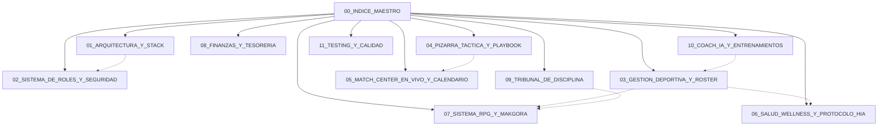

# 🛡️ RUGBY ORCOS NEGROS — ÍNDICE MAESTRO (MOC)

> [!NOTE]
> Este archivo actúa como **Map of Content (MOC)** para navegar en **Obsidian** a través de toda la arquitectura, módulos, motores de dominio, protocolos médicos, reglamentación deportiva y guías operativas del club.



---

## 📚 Mapa de Capítulos y Módulos

### 1. Núcleo Técnico y Base de la Plataforma
* **[[01_ARQUITECTURA_Y_STACK]]**: Filosofía Supabase-First, caché local-first resistente en cancha, árbol de contextos de React, PWA offline con Service Worker y motores nativos (Canvas 2D y Web Audio API).
* **[[02_SISTEMA_DE_ROLES_Y_SEGURIDAD]]**: Control de acceso basado en roles (RBAC), Row Level Security (RLS) en PostgreSQL, autenticación JWT y directivas de cabeceras HTTP (CSP, HSTS, X-Frame-Options).

### 2. Gestión Deportiva y Rendimiento
* **[[03_GESTION_DEPORTIVA_Y_ROSTER]]**: Manejo de las 4 categorías (`masculina_mayor`, `femenina_mayor`, `juveniles_masculina`, `juveniles_femenin`), fichas de contacto, indumentaria y marcas 1RM de gimnasio.
* **[[04_PIZARRA_TACTICA_Y_PLAYBOOK]]**: Simulador de Rugby XV y Sevens, 11 formaciones predefinidas, drag & drop de dorsales, modo TV animado en fases y exportación de acta oficial en PDF.
* **[[05_MATCH_CENTER_EN_VIVO_Y_CALENDARIO]]**: Tablero en vivo con periodos reglamentarios, silbato arbitral sintético Fox 40 Classic, sincronización iCalendar RFC 5545 (`.ics`), historial cara a cara y generador de banners de resultado para WhatsApp.

### 3. Salud, Bienestar y Gamificación
* **[[06_SALUD_WELLNESS_Y_PROTOCOLO_HIA]]**: Protocolo oficial de evaluación de traumatismo craneoencefálico (HIA) de World Rugby, control de reposo, radar de fatiga y Sin-Bin disciplinario.
* **[[07_SISTEMA_RPG_Y_MAKGORA]]**: Motor de cálculo de atributos `attributeCalculator.js`, normalización métrica y de posiciones, cálculo de OVR, rangos Makgora y fichas de colección Trading Card (1200x1200px).

### 4. Administración, Comunidad y Soporte
* **[[08_FINANZAS_Y_TESORERIA]]**: Libro diario de ingresos y egresos, cuotas mensuales por jugador, balances y exportación de reportes PDF.
* **[[09_TRIBUNAL_DE_DISCIPLINA]]**: Registro de infracciones en campo y extradeportivas, sanciones económicas, servicio comunitario y ranking de honor.
* **[[10_COACH_IA_Y_ENTRENAMIENTOS]]**: Training Hub con periodización de cargas y asistente táctico inteligente con arquitectura de fallback (Groq, DeepSeek, Gemini, OpenRouter).
* **[[11_TESTING_Y_CALIDAD]]**: Suite de 67 archivos de pruebas (626 tests en Vitest), Happy-DOM, ESLint con cero advertencias permitidas y pipelines de integración continua.

---

## ⚡ Comandos Rápidos y Entorno de Trabajo

```bash
# Servidor local de desarrollo
npm run dev

# Ejecutar la suite completa de 626 tests
npx vitest run

# Comprobar linter con cero advertencias
npm run lint

# Construir bundle optimizado de producción para PWA
npm run build
```

> [!TIP]
> En Obsidian, pulsa `Ctrl + G` para abrir la **Vista de Grafo** (Graph View) y visualizar las interconexiones entre todos los módulos del club.
