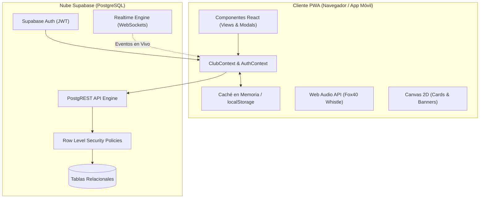

# 01 — Arquitectura de Software y Stack Tecnológico

Volver a: [[00_INDICE_MAESTRO]] | Siguiente: [[02_SISTEMA_DE_ROLES_Y_SEGURIDAD]]

---

## 1. Principio Fundamental: Supabase-First con Caché Local Resiliente

La arquitectura de **Rugby Orcos Negros Club Manager** está concebida bajo la filosofía **Supabase-First**:



1. **Fuente de Verdad Única:** PostgreSQL alojado en Supabase es el único repositorio definitivo de datos.
2. **Mutaciones Atómicas:** Cada operación de guardado ejecuta un `upsert` con timestamps ISO 8601 (`updated_at`).
3. **Resiliencia en Canchas (Modo Sin Red):** Si el dispositivo pierde la señal de red mientras el equipo está en un campo de juego, la aplicación detecta el estado offline (`syncStatus = 'offline'`) permitiendo consultar listas, tácticas y formaciones previamente cargadas sin bloqueos.

---

## 2. Stack de Tecnologías

| Dimensión | Herramienta | Versión | Justificación Técnica |
|---|---|---|---|
| **Runtime & UI** | React | 18.2.0 | Modelo declarativo con árbol de contextos optimizado para estado global deportivo. |
| **Bundler** | Vite | 8.0.x | Tiempos de recarga HMR inferiores a 50ms y generación de chunks ESM ligeros. |
| **Estilos** | CSS3 + Variables | Nativo | Glassmorphism con paleta oscura neón (`#00e676`, `#ffd740`, `#060d13`) sin overhead de frameworks pesados. |
| **Base de Datos** | Supabase PostgreSQL | v2 JS Client | Relaciones estructuradas, triggers automáticos y políticas RLS por usuario. |
| **PWA & Offline** | Workbox (vite-plugin-pwa) | 1.3.0 | Precaching de más de 90 recursos para garantizar instalación en Android e iOS. |
| **Síntesis de Audio** | Web Audio API | Nativo | Genera los tonos de un silbato Fox 40 en tiempo real sin transferir archivos de sonido. |
| **Generación Gráfica** | Canvas 2D API | Nativo | Composición de imágenes PNG a 1200x1200px para redes sociales. |
| **Impresión & PDF** | Window.print + CSS Media | Nativo | Renderizado de actas oficiales y paz y salvos vectoriales listos para imprimir. |

---

## 3. Desglose del Árbol de Estado (`ClubContext.jsx`)

Para evitar monolitos inmanejables, el contexto global se descompone en hooks especializados:

```
src/context/
├── AuthContext.jsx       # Sesión, usuario activo, credenciales y verificación de roles
├── ClubContext.jsx       # Orquestador del estado central y despacho de acciones
├── ToastContext.jsx      # Notificaciones no intrusivas en pantalla
└── hooks/
    ├── usePlayers.js     # Altas, bajas, edición de biometría y marcas 1RM
    ├── useMatches.js     # Programación de partidos, marcadores en vivo y tarjetas
    ├── useFinances.js    # Tesorería, libro diario, balances y cuotas
    ├── useSync.js        # Sincronización bidireccional con Supabase
    ├── useFundraising.js # Rifas, donaciones y metas del club
    └── useDataIO.js      # Respaldos y restauración JSON integral
```

---

## 4. Estrategia de Caché PWA y Despliegue

El archivo `dist/sw.js` generado automáticamente por Vite PWA mantiene en caché:
* Archivos HTML, JS y CSS principales.
* Fuentes tipográficas y logotipos del club.
* Formularios y esquemas de datos.

> [!NOTE]
> Al implementarse en Vercel o Netlify, se aplican cabeceras de caché inmutable (`Cache-Control: public, max-age=31536000, immutable`) para assets con hash de compilación.

Ver siguiente: [[02_SISTEMA_DE_ROLES_Y_SEGURIDAD]]
