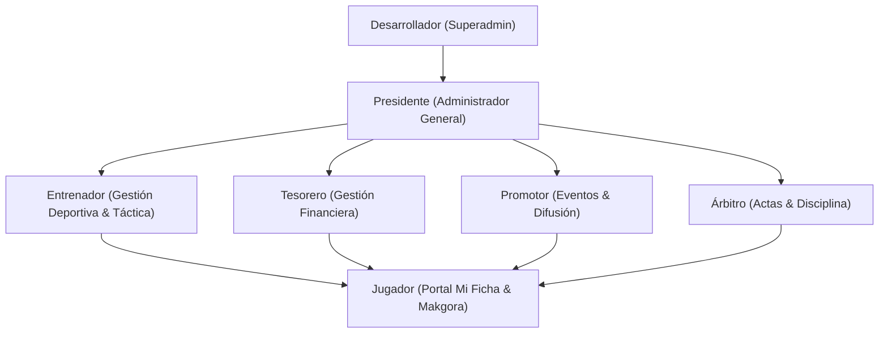

# 02 — Sistema de Roles, Permisos y Seguridad

Volver a: [[00_INDICE_MAESTRO]] | Anterior: [[01_ARQUITECTURA_Y_STACK]] | Siguiente: [[03_GESTION_DEPORTIVA_Y_ROSTER]]

---

## 1. Modelo de Control de Acceso Basado en Roles (RBAC)

La aplicación implementa una jerarquía estricta de 7 roles de usuario administrados en [`AuthContext.jsx`](file:///C:/Users/KennentDVA/Documents/Proyectos_Code/Rugby%20Orcos/src/context/AuthContext.jsx):



### Matriz de Permisos por Rol

| Módulo / Acción | Desarrollador | Presidente | Entrenador | Tesorero | Promotor | Árbitro | Jugador |
|---|:---:|:---:|:---:|:---:|:---:|:---:|:---:|
| **Ver Métricas Generales** | ✅ | ✅ | ✅ | ✅ | ✅ | ✅ | ❌ |
| **Gestionar Roster (Altas/Bajas)** | ✅ | ✅ | ✅ | ❌ | ❌ | ❌ | ❌ |
| **Pizarra Táctica & Alineaciones** | ✅ | ✅ | ✅ | ❌ | ❌ | 👁️ Lectura | 👁️ Lectura |
| **Registrar Marcador en Vivo** | ✅ | ✅ | ✅ | ❌ | ❌ | ✅ | ❌ |
| **Libro de Finanzas & Cuotas** | ✅ | ✅ | ❌ | ✅ | ❌ | ❌ | ❌ |
| **Tribunal de Disciplina & Sanciones**| ✅ | ✅ | ✅ | ❌ | ❌ | ✅ | 👁️ Consulta |
| **Portal "Mi Ficha" Personal** | ✅ | ✅ | ✅ | ✅ | ✅ | ✅ | ✅ (Propia) |
| **Desafíos Makgora RPG** | ✅ | ✅ | ✅ | ✅ | ✅ | ✅ | ✅ |
| **Configuración de Proveedores IA** | ✅ | ✅ | ❌ | ❌ | ❌ | ❌ | ❌ |

---

## 2. Seguridad en Base de Datos: Row Level Security (RLS)

En PostgreSQL, cada tabla cuenta con directivas RLS para evitar que usuarios no autorizados puedan sobreescribir datos ajenos:

```sql
-- Ejemplo de Política RLS para Mi Ficha de Jugador
CREATE POLICY "Permitir a jugadores actualizar solo su propio perfil"
ON public.players
FOR UPDATE
USING (auth.uid() = user_id)
WITH CHECK (auth.uid() = user_id);

-- Política RLS para el Libro Contable (Solo Tesoreros y Presidencia)
CREATE POLICY "Acceso restringido a finanzas"
ON public.finances
FOR ALL
USING (
  EXISTS (
    SELECT 1 FROM public.profiles
    WHERE profiles.id = auth.uid()
    AND profiles.role IN ('desarrollador', 'presidente', 'tesorero')
  )
);
```

---

## 3. Hardening de Cabeceras HTTP en Producción

Los archivos de despliegue (`vercel.json` y `netlify.toml`) fuerzan las siguientes cabeceras de seguridad:

1. **Content-Security-Policy (CSP):**
   - Limita las fuentes de scripts exclusivamente a `'self'` y scripts autorizados.
   - Habilita conexiones WebSocket seguras con `wss://*.supabase.co`.
   - Bloquea la inyección de código mediante marcos externos (`frame-ancestors 'none'`).
2. **X-Frame-Options: DENY:**
   - Evita ataques de clickjacking protegiendo la UI contra incrustaciones en iframes.
3. **X-Content-Type-Options: nosniff:**
   - Impide que el navegador interprete archivos con tipos MIME diferentes al declarado.
4. **Strict-Transport-Security (HSTS):**
   - Exige HTTPS con precarga durante al menos 1 año (`max-age=31536000; includeSubDomains; preload`).
5. **Permissions-Policy:**
   - Desactiva el acceso innecesario a micrófono, cámara y geolocalización (`camera=(), microphone=(), geolocation=()`).

Ver siguiente: [[03_GESTION_DEPORTIVA_Y_ROSTER]]
