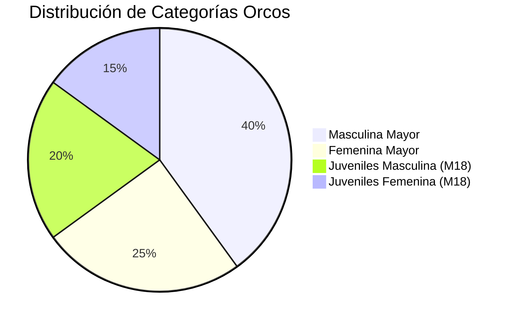

# 03 — Gestión Deportiva, Roster y Fichas de Guerreros

Volver a: [[00_INDICE_MAESTRO]] | Anterior: [[02_SISTEMA_DE_ROLES_Y_SEGURIDAD]] | Siguiente: [[04_PIZARRA_TACTICA_Y_PLAYBOOK]]

---

## 1. Estructura de Categorías del Club

El club administra a sus integrantes a través de 4 divisiones deportivas:



* **`masculina_mayor`**: Plantel principal de caballeros (Rugby XV y Sevens competitivo).
* **`femenina_mayor`**: Plantel principal de damas (Orcas Rugby Club).
* **`juveniles_masculina`**: Semillero y divisiones formativas menores de 18 años.
* **`juveniles_femenin`**: División formativa juvenil femenina.

---

## 2. Anatomía de la Ficha Integral de Jugador

Cada guerrero cuenta con un modelo de datos estructurado en [`src/schema/playerSchema.js`](file:///C:/Users/KennentDVA/Documents/Proyectos_Code/Rugby%20Orcos/src/schema/playerSchema.js) validado con esquemas estrictos:

```
┌─────────────────────────────────────────────────────────────┐
│                 FICHA TÉCNICA DEL GUERRERO                  │
├─────────────────────────────────────────────────────────────┤
│ 1. IDENTIDAD BÁSICA                                         │
│    • Nombre, Apellidos, Apodo / Alias de Combate            │
│    • Documento de Identidad y Fecha de Nacimiento           │
│    • Dorsal / Camiseta Habitual y Rol de Capitán/Líder      │
├─────────────────────────────────────────────────────────────┤
│ 2. BIOMETRÍA Y SALUD                                        │
│    • Estatura (en m o cm) y Peso (kg)                       │
│    • Tipo de Sangre (RH) y EPS / Seguro Médico              │
│    • Historial de Lesiones y Conmociones Cerebrales (HIA)   │
├─────────────────────────────────────────────────────────────┤
│ 3. PERFIL TÁCTICO                                           │
│    • Posición Principal (ej. Primera Línea, Apertura)       │
│    • Posición Secundaria y Preferencia de Ala               │
│    • Eficiencia de Placaje y Dominio en Formaciones Fijas   │
├─────────────────────────────────────────────────────────────┤
│ 4. RENDIMIENTO EN GIMNASIO (1RM COMBINE)                   │
│    • Press de Banca (kg)                                    │
│    • Sentadilla Profunda (kg)                               │
│    • Peso Muerto (kg)                                       │
├─────────────────────────────────────────────────────────────┤
│ 5. INDUMENTARIA & EQUIPAMIENTO                              │
│    • Talla de Camiseta (Jersey), Pantaloneta y Zapatos      │
└─────────────────────────────────────────────────────────────┘
```

---

## 3. Préstamos y Traspasos entre Clubes (`loans`)

El sistema incluye control reglamentario para jugadores prestados a otras instituciones o recibidos temporalmente:
* Registro de fecha de inicio y finalización del préstamo.
* Club de origen y club de destino.
* Estado de habilitación para torneos oficiales regionales o nacionales.

---

## 4. Generación de Certificados Oficiales en PDF

Desde el portal **Mi Ficha** ([`PlayerDashboard.jsx`](file:///C:/Users/KennentDVA/Documents/Proyectos_Code/Rugby%20Orcos/src/components/PlayerDashboard.jsx)), cualquier jugador con credenciales al día puede generar automáticamente su:

* **Paz y Salvo Oficial:** Certifica que el deportista no adeuda cuotas de mensualidad ni registra sanciones pendientes en el Tribunal Disciplinario.
* **Certificado de Afiliación Deportiva:** Documento formal con membrete del club y firma electrónica de presidencia para presentación ante ligas y entidades deportivas.

Ver siguiente: [[04_PIZARRA_TACTICA_Y_PLAYBOOK]]
