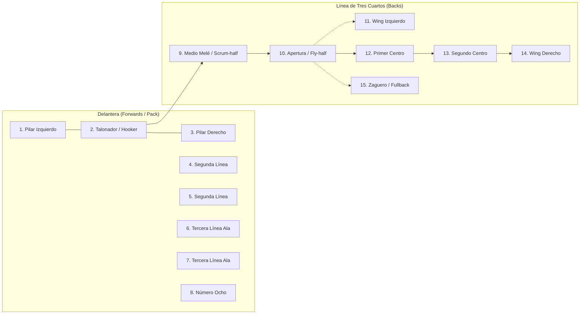

# 04 — Pizarra Táctica, Formaciones y Playbook TV

Volver a: [[00_INDICE_MAESTRO]] | Anterior: [[03_GESTION_DEPORTIVA_Y_ROSTER]] | Siguiente: [[05_MATCH_CENTER_EN_VIVO_Y_CALENDARIO]]

---

## 1. Modos de Juego y Formaciones Soportadas

El módulo de Pizarra Táctica ([`CanchaTactica/index.jsx`](file:///C:/Users/KennentDVA/Documents/Proyectos_Code/Rugby%20Orcos/src/components/CanchaTactica/index.jsx)) ofrece soporte completo para:

* **Rugby XV:** 15 jugadores titulares + suplentes estratégicos.
* **Rugby Sevens (7s):** Modalidad olímpica de 7 jugadores (3 Forwards + 4 Backs).

---

## 2. Catálogo de 11 Formaciones Estratégicas

1. **Scrum / Melé Defensivo (XV):** Empuje compacto en campo propio con cobertura del número 8 y medio melé.
2. **Scrum / Melé Ofensivo (XV):** Lanzamiento de tres cuartos con ángulo de salida rápido.
3. **Lineout Completo (7 saltadores):** Variantes de salto en poste 2, 4 y 6 con maul posterior estructurado.
4. **Lineout Reducido (5 saltadores):** Mayor espacio exterior para ataque directo de los centros.
5. **Lineout Rápido (Quick throw):** Transición vertiginosa antes del armado defensivo rival.
6. **Ruck Defensivo:** Barrera de guardia y pivote (Guard & Pillar) para tapar salidas pegadas al ruck.
7. **Salida de 22 Metros:** Recepción de patada con descarga aérea y bloqueo perimetral.
8. **Recepción de Kickoff (Salida de Centro):** Cuña de recepción en media cancha.
9. **Defensa Desplegada (Up & In / Drift):** Cobertura por zonas para evitar quiebres exteriores.
10. **Ataque en Oleadas (Pods de Forwards):** Sistema 3-3-2 con aperturas escalonadas.
11. **Formación Rugby Sevens (3-4 Clásica):** Cobertura total de los 70 metros de ancho del terreno.

---

## 3. Modo Playbook TV con Animación Multicapa por Fases

El **Modo TV** permite reproducir en pantallas grandes o proyectores de vestuario las jugadas ensayadas con movimientos descompuestos en múltiples fases pausadas y didácticas:

* **Jugada 1 — Ataque Cruzado (Switch Attack):** El apertura amaga apertura larga y descarga en cruce interior con el primer centro.
* **Jugada 2 — Maul Dinámico:** Entrada al lineout, fijación del balón en el saltador y avance en cuña hasta zona de in-goal.
* **Jugada 3 — 8-9 Pick and Go (6 Fases Animadas):** Ataque perimetral corto en la base del scrum para desgastar la primera línea defensiva y habilitar try en la esquina.
* **Jugada 4 — Up and Under (Patada de Presión y Recuperación Aérea):** Patada alta de la apertura con persecución agresiva de los wings para ganar posesión bajo rebote.

---

## 4. Impresión del Acta Oficial de Partido (PDF)

Mediante la función `printOfficialMatchSheet` ([`exportPdf.js`](file:///C:/Users/KennentDVA/Documents/Proyectos_Code/Rugby%20Orcos/src/utils/exportPdf.js)), el entrenador genera con un solo clic la **Planilla Oficial de Alineación** con:
* Listado de los 15 titulares con su dorsal asignado y posición.
* Listado de los suplentes (números 16 al 23).
* Indicación de primera línea capacitado para scrum pactado.
* Firmas del Capitán, Entrenador Principal y Árbitro Central.

Ver siguiente: [[05_MATCH_CENTER_EN_VIVO_Y_CALENDARIO]]
