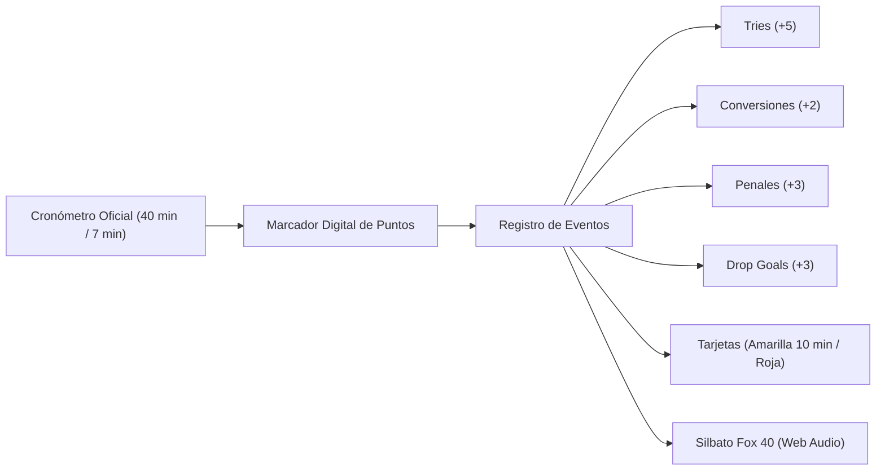

# 05 — Match Center en Vivo, Silbato Web Audio y Calendario

Volver a: [[00_INDICE_MAESTRO]] | Anterior: [[04_PIZARRA_TACTICA_Y_PLAYBOOK]] | Siguiente: [[06_SALUD_WELLNESS_Y_PROTOCOLO_HIA]]

---

## 1. Match Center en Tiempo Real

Durante la disputa de un encuentro oficial o amistoso, la pantalla de partido ([`MatchSquadModal.jsx`](file:///C:/Users/KennentDVA/Documents/Proyectos_Code/Rugby%20Orcos/src/components/CanchaTactica/MatchSquadModal.jsx)) se transforma en una mesa de control:



---

## 2. Silbato Arbitral Digital Sintetizado (`rugbyAudio.js`)

Para aportar máxima inmersión en entrenamientos y partidos sin depender de archivos de audio externos (los cuales pueden tardar en descargar o fallar sin conexión), se desarrolló un sintetizador acústico basado en la **Web Audio API** ([`rugbyAudio.js`](file:///C:/Users/KennentDVA/Documents/Proyectos_Code/Rugby%20Orcos/src/utils/rugbyAudio.js)):

* **Simulación Acústica del Fox 40 Classic:** Utiliza un oscilador doble con dos frecuencias portadoras principales (aprox. **3100 Hz** y **3400 Hz**) con modulación de frecuencia cruzada (FM) para generar el característico batimiento o trino agudo estridente.
* **Sonidos Reglamentarios Disponibles:**
  1. `playWhistle('kickoff')`: Pitido prolongado ascendente con trino para inicio de tiempo.
  2. `playWhistle('try')`: Secuencia rápida de 3 pitidos contundentes celebrando la anotación.
  3. `playWhistle('penalty')`: Pitido seco y agudo cortado en seco.
  4. `playWhistle('fulltime')`: Pitido doble extendido marcando el final reglamentario.
* **Control de Silencio:** Interruptor de activación/desactivación persistente en la cabecera del partido.

---

## 3. Generador de Banner Oficial y Resumen para WhatsApp

Al finalizar el partido o durante el entretiempo, los coordinadores pueden pulsar el botón **"Compartir Marcador"**:

1. **Banner Gráfico HD (Canvas 2D):** Genera una imagen PNG a 1200x675px con el escudo de Orcos Negros, el nombre del rival, marcador final, fecha, cancha y desglose de anotadores.
2. **Formato Automático para WhatsApp:** Copia al portapapeles un texto con emojis y formato limpio listo para pegar en el grupo del club:

```text
🏉 *RUGBY ORCOS NEGROS CLUB — RESULTADO OFICIAL* 🏉
━━━━━━━━━━━━━━━━━━━━━━━━━━
⚔️ *ORCOS NEGROS* 27 - 12 *BOGOTÁ BARBARIANS*
📍 Cancha: Unidad Deportiva El Salitre (Bogotá)
🏆 Torneo: Liga Mayor de Rugby XV - Fecha 4

✨ *Anotadores de Honor:*
• Try: Juan Camilo Gómez (Min 14')
• Try: Carlos "Toro" Rivas (Min 38')
• Conversión: Santiago Morales (x2)
• Penal: Santiago Morales (Min 62')

💪 _¡Fuerza, honor y tercer tiempo!_
```

---

## 4. Sincronización de Calendario iCalendar RFC 5545 (`.ics`)

El módulo de calendario permite descargar la agenda de partidos y prácticas en formato estándar `.ics` ([`exportCalendarIcs.js`](file:///C:/Users/KennentDVA/Documents/Proyectos_Code/Rugby%20Orcos/src/utils/exportCalendarIcs.js)):
* Compatible con **Google Calendar, Apple Calendar y Microsoft Outlook**.
* Configura alarmas de recordatorio 24 horas y 2 horas antes de la patada inicial.
* Incluye ubicación GPS o dirección de la cancha en el campo `LOCATION`.

---

## 5. Historial Cara a Cara (Head-to-Head)

Al seleccionar cualquier rival futuro en el fixture, el sistema calcula de forma instantánea el récord histórico frente a dicho oponente:
* Total de partidos disputados.
* Victorias, empates y derrotas.
* Puntos a favor, puntos en contra y diferencia de try promedio.

Ver siguiente: [[06_SALUD_WELLNESS_Y_PROTOCOLO_HIA]]
