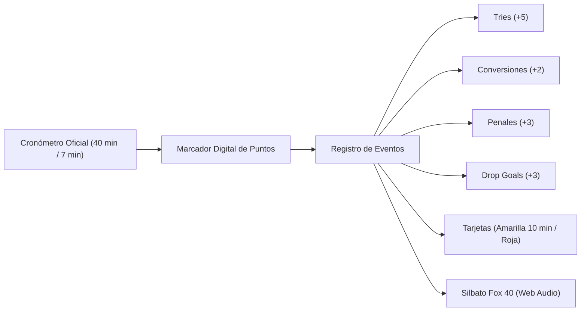

# 05 — Match Center en Vivo, Silbato Web Audio y Calendario

Volver a: [[00_INDICE_MAESTRO]] | Anterior: [[04_PIZARRA_TACTICA_Y_PLAYBOOK]] | Siguiente: [[06_SALUD_WELLNESS_Y_PROTOCOLO_HIA]]

---

## 1. Match Center en Tiempo Real

Durante la disputa de un encuentro oficial o amistoso, la pantalla de partido ([`MatchSquadModal.jsx`](file:///C:/Users/KennentDVA/Documents/Proyectos_Code/Rugby%20Orcos/src/components/CanchaTactica/MatchSquadModal.jsx)) se transforma en una mesa de control:



---

## 2. Silbato Arbitral Digital Sintetizado (`rugbyAudio.js`)

Para aportar máxima inmersión en entrenamientos y partidos sin depender de archivos de audio externos (los cuales pueden tardar en descargar o fallar sin conexión), se desarrolló un sintetizador acústico basado en la **Web Audio API** ([`rugbyAudio.js`](file:///C:/Users/KennentDVA/Documents/Proyectos_Code/Rugby%20Orcos/src/utils/rugbyAudio.js)):

* **Simulación Acústica del Fox 40 Classic:** Utiliza un oscilador doble con dos frecuencias portadoras principales (aprox. **3100 Hz** y **3400 Hz**) con modulación de frecuencia cruzada (FM) para generar el característico batimiento o trino agudo estridente.
* **Sonidos Reglamentarios Disponibles:**
  1. `playWhistle('kickoff')`: Pitido prolongado ascendente con trino para inicio de tiempo.
  2. `playWhistle('try')`: Secuencia rápida de 3 pitidos contundentes celebrando la anotación.
  3. `playWhistle('penalty')`: Pitido seco y agudo cortado en seco.
  4. `playWhistle('fulltime')`: Pitido doble extendido marcando el final reglamentario.
* **Control de Silencio:** Interruptor de activación/desactivación persistente en la cabecera del partido.

---

## 3. Generador de Banner Oficial y Resumen para WhatsApp

Al finalizar el partido o durante el entretiempo, los coordinadores pueden pulsar el botón **"Compartir Marcador"**:

1. **Banner Gráfico HD (Canvas 2D):** Genera una imagen PNG a 1200x675px con el escudo de Orcos Negros, el nombre del rival, marcador final, fecha, cancha y desglose de anotadores.
2. **Formato Automático para WhatsApp:** Copia al portapapeles un texto con emojis y formato limpio listo para pegar en el grupo del club:

```text
🏉 *RUGBY ORCOS NEGROS CLUB — RESULTADO OFICIAL* 🏉
━━━━━━━━━━━━━━━━━━━━━━━━━━
⚔️ *ORCOS NEGROS* 27 - 12 *BOGOTÁ BARBARIANS*
📍 Cancha: Unidad Deportiva El Salitre (Bogotá)
🏆 Torneo: Liga Mayor de Rugby XV - Fecha 4

✨ *Anotadores de Honor:*
• Try: Juan Camilo Gómez (Min 14')
• Try: Carlos "Toro" Rivas (Min 38')
• Conversión: Santiago Morales (x2)
• Penal: Santiago Morales (Min 62')

💪 _¡Fuerza, honor y tercer tiempo!_
```

---

## 4. Sincronización de Calendario iCalendar RFC 5545 (`.ics`)

El módulo de calendario permite descargar la agenda de partidos y prácticas en formato estándar `.ics` ([`exportCalendarIcs.js`](file:///C:/Users/KennentDVA/Documents/Proyectos_Code/Rugby%20Orcos/src/utils/exportCalendarIcs.js)):
* Compatible con **Google Calendar, Apple Calendar y Microsoft Outlook**.
* Configura alarmas de recordatorio 24 horas y 2 horas antes de la patada inicial.
* Incluye ubicación GPS o dirección de la cancha en el campo `LOCATION`.

---

## 5. Historial Cara a Cara (Head-to-Head)

Al seleccionar cualquier rival futuro en el fixture, el sistema calcula de forma instantánea el récord histórico frente a dicho oponente:
* Total de partidos disputados.
* Victorias, empates y derrotas.
* Puntos a favor, puntos en contra y diferencia de try promedio.

---

## 6. Protocolo de Retraso de Partido y Realidad Regional (Corozal, Sucre)

En el Caribe colombiano y en el departamento de Sucre, los partidos de rugby a menudo enfrentan contingencias operativas antes del pitazo inicial. Para reflejar con precisión la realidad sin distorsionar el tiempo de juego efectivo (80 min en XV o 14 min en Sevens), el sistema cuenta con el **Protocolo de Retraso de Partido** ([`MatchDelayModal.jsx`](file:///C:/Users/KennentDVA/Documents/Proyectos_Code/Rugby%20Orcos/src/components/Calendario/FixtureTab/LiveMatch/MatchDelayModal.jsx)):

1. **Estado `delayed` / En Espera:** Mantiene el cronómetro oficial en cero o pausado.
2. **Causas Regionales Predefinidas:**
   - 🚌 *Retraso en transporte intermunicipal en carretera (Sincelejo / Montería / Barranquilla / Cartagena).*
   - 🚑 *Espera obligatoria de paramédico o cuerpo de socorro / ambulancia en cancha municipal de Corozal.*
   - ⛈️ *Tormenta tropical caribeña o alerta de descargas eléctricas.*
   - ⏱️ *Partido preliminar alargado (tiempo extra en juvenil o femenino).*
   - 📋 *Verificación oficial de planillas, carnets y fichajes FCR con capitanes y árbitros.*
3. **Ticker Global en Vivo:** La barra superior de la app notifica a todos los miembros del club el estado `"PARTIDO EN ESPERA (COROZAL): [Motivo]"`.
4. **Desbloqueo de Kickoff:** Al sonar el pitazo inicial del referee, el operador presiona *"¡Pitazo de Kickoff Confirmado!"*, emitiendo el sonido acústico del silbato y arrancando el tiempo oficial.

---

## 7. Mesa de Control Oficial y Guardrail de Modo Espectador

Para prevenir anotaciones accidentales provocadas por aficionados o jugadores que consultan el marcador desde la tribuna o banquillo, se diseñó la **Mesa de Control Oficial** ([`LiveScorer.jsx`](file:///C:/Users/KennentDVA/Documents/Proyectos_Code/Rugby%20Orcos/src/components/Calendario/FixtureTab/LiveMatch/LiveScorer.jsx)):

1. **Asignación del Planillero Designado:** El árbitro de mesa, delegado de campo o entrenador puede asignarse o registrarse como responsable oficial del acta.
2. **Bloqueo Fail-Closed:** Cuando la mesa está asignada y bloqueada:
   - Los usuarios regulares entran automáticamente en **Modo Espectador**: los botones de try, conversiones y tarjetas quedan desactivados con un aviso visible que indica quién es el juez de mesa autorizado.
   - Solo el planillero designado o usuarios con permisos de staff/coach pueden computar puntos y sanciones disciplinarias.
3. **Reclamación de Mesa:** Permite a un delegado de mesa presionar *"Soy el Planillero"* para tomar el control de forma rápida si hubo cambio de turno.

---

## 8. Iconografía Bélica Orca de Rugby (`OrcosIcons.jsx`)

Para sustituir íconos genéricos por símbolos que reflejen la identidad bélica, la fuerza tribal y la tradición orca, se implementó el conjunto vectorial bespoke ([`OrcosIcons.jsx`](file:///C:/Users/KennentDVA/Documents/Proyectos_Code/Rugby%20Orcos/src/components/common/OrcosIcons.jsx)):

* **Balón Oval Tribal (`OrcosRugbyBallIcon`):** Balón de cuero oscuro con costuras reforzadas y colmillos en los vértices.
* **Haches y Hacha de Guerra (`OrcosBattleAxeHPostsIcon`):** Postes de try entrelazados con hojas dobles de hacha orca para conversiones y penales.
* **Escudo Forjado de Placaje (`OrcosTackleShieldIcon`):** Broquel de hierro remachado con marcas de impacto.
* **Cuerno de Guerra del Tercer Tiempo (`OrcosThirdTimeHornIcon`):** Cuerno ceremonial con cerveza y espuma de victoria.
* **Silbato Metálico Fox 40 (`OrcosWhistleIcon`):** Silbato arbitral forjado.
* **Reloj de Arena Bélico (`OrcosDelayClockIcon`):** Temporizador de guerra para retrasos de partido.
* **Estandarte de Batalla (`OrcosWarBannerIcon`):** Pendón de guerra del club para el Salón de la Fama.
* **Tarjetas Disciplinarias (`OrcosCardIcon`):** Tarjetas amarilla y roja de sin-bin y expulsión.

Ver siguiente: [[06_SALUD_WELLNESS_Y_PROTOCOLO_HIA]]
