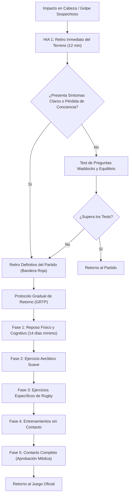

# 06 — Salud, Bienestar y Protocolo de Conmoción HIA

Volver a: [[00_INDICE_MAESTRO]] | Anterior: [[05_MATCH_CENTER_EN_VIVO_Y_CALENDARIO]] | Siguiente: [[07_SISTEMA_RPG_Y_MAKGORA]]

---

## 1. Protocolo Oficial HIA (Head Injury Assessment) de World Rugby

Dado el contacto inherente al rugby, la aplicación integra el protocolo de evaluación de conmociones cerebrales avalado por **World Rugby**:

### Indicadores HIA en el Roster y Dashboard
* **Alerta Roja:** Jugador en periodo de reposo obligatorio. El sistema **bloquea** su inclusión en la alineación titular o suplente de la pizarra táctica para proteger su integridad física.
* **Historial Acumulativo:** Registro de cuántas conmociones ha sufrido el deportista en su trayectoria para alertar al cuerpo médico ante riesgos de síndrome de segundo impacto.

---

## 2. Monitor de Bienestar Diario (Wellness Radar)

Antes de cada entrenamiento de alta intensidad, los jugadores registran 5 variables en escala de 1 a 5:
1. **Calidad del Sueño:** Horas y profundidad del descanso.
2. **Nivel de Fatiga:** Carga residual de sesiones anteriores.
3. **Dolor Muscular (DOMS):** Zonas específicas con dolor o contractura.
4. **Nivel de Estrés:** Carga académica, laboral o personal.
5. **Estado de Ánimo:** Disposición mental para el contacto.

> [!IMPORTANT]
> Un puntaje combinado inferior a 14/25 enciende una recomendación automática del sistema para ajustar la carga individual del jugador a ejercicios regenerativos o trabajo diferenciado.

---

## 3. Monitor de Sin-Bin Disciplinario

> Desde 2026-11-06 el cronómetro ya no está en el panel de Inicio: vive en el partido en vivo (Match Center), ver [[05_MATCH_CENTER_EN_VIVO_Y_CALENDARIO]].

El partido en vivo monitorea el tiempo de los jugadores castigados con tarjeta amarilla:
* Cronómetro regresivo de **10 minutos reglamentarios**.
* Alerta sonora y visual en el momento exacto en que expira la sanción para que el jugador reingrese al campo.

Ver siguiente: [[07_SISTEMA_RPG_Y_MAKGORA]]
