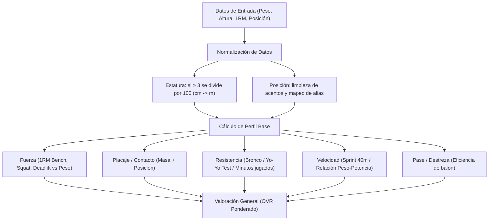

# 07 — Gamificación RPG, Motor de Atributos y Makgora Hub

Volver a: [[00_INDICE_MAESTRO]] | Anterior: [[06_SALUD_WELLNESS_Y_PROTOCOLO_HIA]] | Siguiente: [[08_FINANZAS_Y_TESORERIA]]

---

## 1. Filosofía de Gamificación Makgora

Inspirado en la mitología orca de honor, fuerza y superación constante, el **Makgora Hub** transforma la preparación deportiva en una aventura de rol (RPG) donde el esfuerzo en entrenamientos, gimnasio y partidos otorga puntos de experiencia (XP) y rangos:

```
Rango I: Recluta del Clan (0 - 500 XP)
  └─► Rango II: Guerrero de Línea (501 - 1,500 XP)
        └─► Rango III: Veterano de Batalla (1,501 - 3,500 XP)
              └─► Rango IV: Campeón del Foso (3,501 - 7,000 XP)
                    └─► Rango V: Cacique de Hierro (7,001+ XP)
```

---

## 2. El Motor de Atributos (`attributeCalculator.js`)

El archivo [`attributeCalculator.js`](file:///C:/Users/KennentDVA/Documents/Proyectos_Code/Rugby%20Orcos/src/engine/attributeCalculator.js) convierte las pruebas físicas en estadísticas de combate (10 a 99 puntos):



### Tabla de Perfiles por Familia de Posiciones

| Posición | Enfoque Principal | Ref. Altura | Ref. Peso | Pesos OVR (Fuerza / Placaje / Resistencia / Vel / Técnica) |
|---|---|:---:|:---:|:---:|
| **Pilares / Hooker** | Fuerza y Scrum | 1.80 m | 105 kg | 35% / 25% / 15% / 10% / 15% |
| **Segunda Línea** | Altura y Lineout | 1.95 m | 108 kg | 30% / 25% / 20% / 10% / 15% |
| **Tercera Línea / N8** | Movilidad y Placaje | 1.88 m | 98 kg | 25% / 30% / 20% / 15% / 10% |
| **Medio Melé / Apertura**| Visión y Pase | 1.76 m | 80 kg | 10% / 15% / 25% / 20% / 30% |
| **Centros** | Impacto y Penetración | 1.83 m | 92 kg | 20% / 25% / 20% / 20% / 15% |
| **Wings / Zaguero** | Velocidad y Evasión | 1.80 m | 82 kg | 10% / 15% / 25% / 35% / 15% |

---

## 3. Generador de Cromos RPG Coleccionables y Fotos Maestras 4K (`exportPlayerCard.js` y `localPhotoStorage.js`)

En el portal **Mi Ficha**, los guerreros pueden pulsar los botones **"🎴 Ficha HD"** o **"💎 Ficha 4K Ultra"**:
* **Almacenamiento Local 4K (IndexedDB):** La foto original en resolución máxima (Full HD / 4K) se guarda de forma 100% local en el dispositivo del jugador, garantizando privacidad y cero consumo de cuota en Supabase.
* **Miniatura Sincronizada:** Se genera automáticamente una versión ligera (~25 KB) para el Roster del DT y compañeros.
* **Renderizado Ultra HD:** El canvas compone a 2400x2400px o 1200x1200px con la foto real del guerrero con halo neón, barras de estadísticas y píldora dinámica de OVR.
* Botón integrado para **Descargar PNG** o **Copiar Imagen Directa al Portapapeles**.

---

## 4. Duelos de Honor Makgora

Los guerreros pueden retarse entre sí a desafíos supervisados por el cuerpo técnico:
* **Prueba de Fuerza:** Duelo de repeticiones en peso corporal.
* **Prueba de Velocidad:** Carrera de 100m o sprint de ida y vuelta.
* **Prueba de Resistencia:** Test de consumo máximo de oxígeno.
* El ganador recibe puntos de prestigio en el ranking interno y mención en el muro de honor.

Ver siguiente: [[08_FINANZAS_Y_TESORERIA]]
