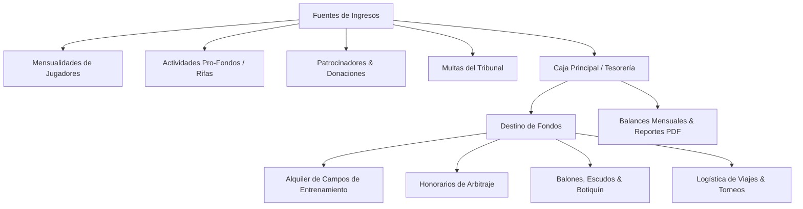

# 08 — Finanzas, Tesorería y Control de Cuotas

Volver a: [[00_INDICE_MAESTRO]] | Anterior: [[07_SISTEMA_RPG_Y_MAKGORA]] | Siguiente: [[09_TRIBUNAL_DE_DISCIPLINA]]

---

## 1. Misión de la Tesorería de Orcos Negros

El módulo de Finanzas ([`Finanzas/index.jsx`](file:///C:/Users/KennentDVA/Documents/Proyectos_Code/Rugby%20Orcos/src/components/Finanzas/index.jsx)) garantiza la transparencia total en la gestión de fondos del club:
* Administración de cuotas de sostenimiento mensual.
* Pago de canchas, arbitrajes y transporte para viajes oficiales.
* Adquisición de balones, conos, escudos de tackle y material médico.
* Fondo solidario para guerreros lesionados o en situación de vulnerabilidad.

---

## 2. Libro Diario de Movimientos

Cada registro contable almacena:
* `id`: Identificador único.
* `fecha`: Fecha y hora de la transacción.
* `tipo`: Ingreso (`income`) o Egreso (`expense`).
* `categoria`: Arbitraje, Cancha, Implementos, Cuotas, Transporte, Tercer Tiempo, Multas.
* `monto`: Valor monetario en Pesos Colombianos (COP).
* `descripcion`: Detalle justificativo del movimiento.
* `comprobante`: URL o referencia de recibo.

---

## 3. Matriz de Control de Cuotas por Jugador

Permite a la mesa directiva y tesorería revisar con semáforo de colores el estado de cada deportista:
* 🟢 **Al Día:** Cuota del mes en curso cancelada.
* 🟡 **Pendiente:** Dentro del periodo de gracia reglamentario.
* 🔴 **Moroso:** Más de 30 días de retraso. Se bloquea la generación de Paz y Salvo.

---

## 4. Exportación de Balances Financieros (PDF)

El tesorero puede generar con un clic un **Informe Contable Oficial en PDF**:
* Resumen ejecutivo: Total Ingresos, Total Gastos, Saldo en Caja.
* Gráfico de desglose porcentual por categorías de gasto.
* Historial cronológico de facturas y firmas de revisoría fiscal.

Ver siguiente: [[09_TRIBUNAL_DE_DISCIPLINA]]
