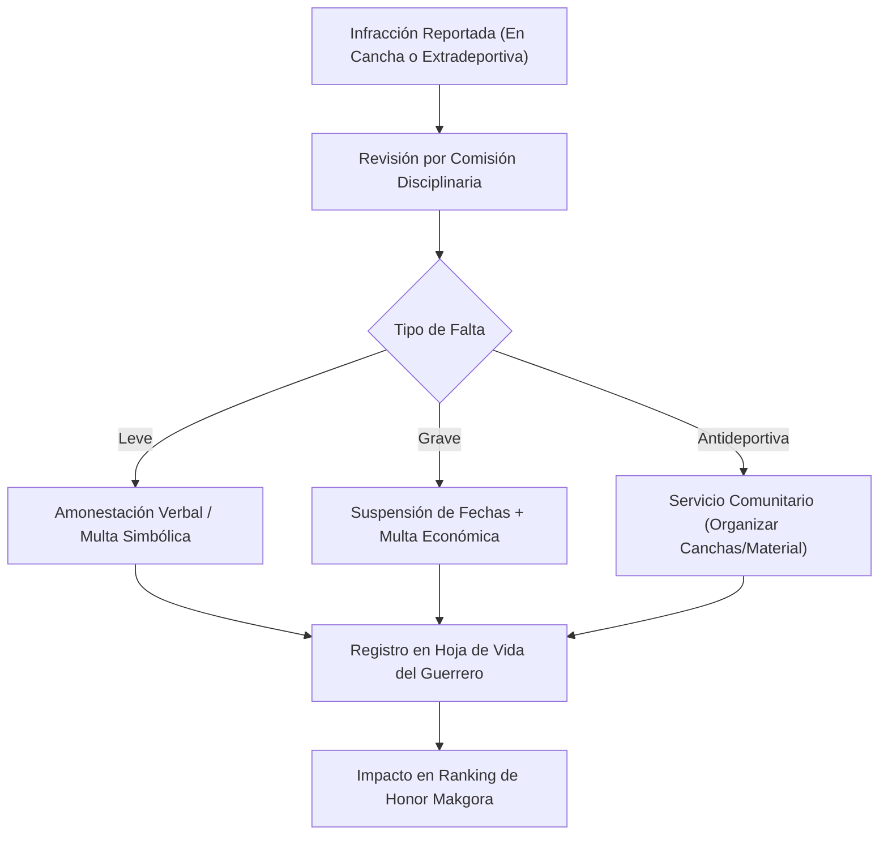

# 09 — Tribunal de Disciplina y Código de Honor

Volver a: [[00_INDICE_MAESTRO]] | Anterior: [[08_FINANZAS_Y_TESORERIA]] | Siguiente: [[10_COACH_IA_Y_ENTRENAMIENTOS]]

---

## 1. Código de Conducta de los Orcos Negros

El rugby se fundamenta en el respeto irrestricto hacia los árbitros, compañeros y rivales. El **Tribunal de Disciplina** ([`Tribunal/index.jsx`](file:///C:/Users/KennentDVA/Documents/Proyectos_Code/Rugby%20Orcos/src/components/Tribunal/index.jsx)) vela por el cumplimiento de los estatutos del club:

---

## 2. Tipificación de Infracciones y Sanciones

| Infracción | Severidad | Sanción Estándar | Consecuencia en Makgora |
|---|:---:|---|:---:|
| **Llegada tarde a citación de partido** | Leve | Multa económica ($5,000 COP) | -50 XP |
| **Inasistencia no justificada a práctica** | Leve | Turno de hidratación en siguiente sesión | -100 XP |
| **Tarjeta Amarilla por juego desleal** | Media | 10 min en partido + Revisión en video | -150 XP |
| **Tarjeta Roja por agresión o tackle peligroso**| Muy Grave | Suspensión mínima de 2 fechas | -500 XP y pérdida temporal de rango |
| **Falta de respeto a la autoridad arbitral** | Grave | Multa económica + Disculpa formal | -300 XP |
| **Daño a instalaciones o indumentaria** | Media | Reposición del costo + Multa | Bloqueo de Paz y Salvo |

---

## 3. Trabajo Comunitario y Redención

Los Orcos Negros creen en la reintegración de sus guerreros. Aquellos sancionados pueden redimir parte de sus penalidades y recuperar honor mediante:
* Marcación y pintura de líneas en el terreno de juego.
* Acondicionamiento y limpieza de balones y protectores.
* Asistencia técnica como aguatero o juez de touch en categorías juveniles.

---

## 4. Ranking de Conducta y Fair Play

El módulo premia a los jugadores con cero tarjetas e intachable historial disciplinario mediante la insignia anual de **"Espíritu de Rugby"** durante la gala de clausura de temporada.

Ver siguiente: [[10_COACH_IA_Y_ENTRENAMIENTOS]]
