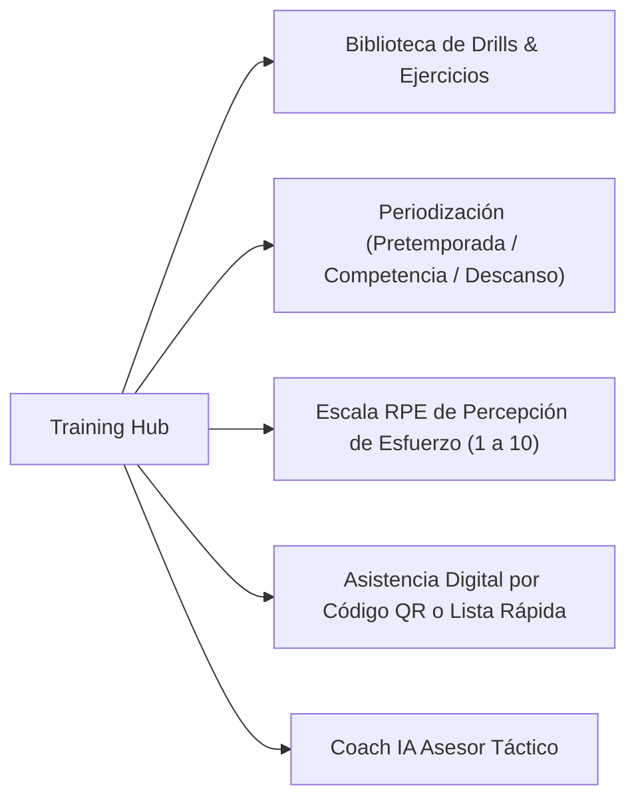
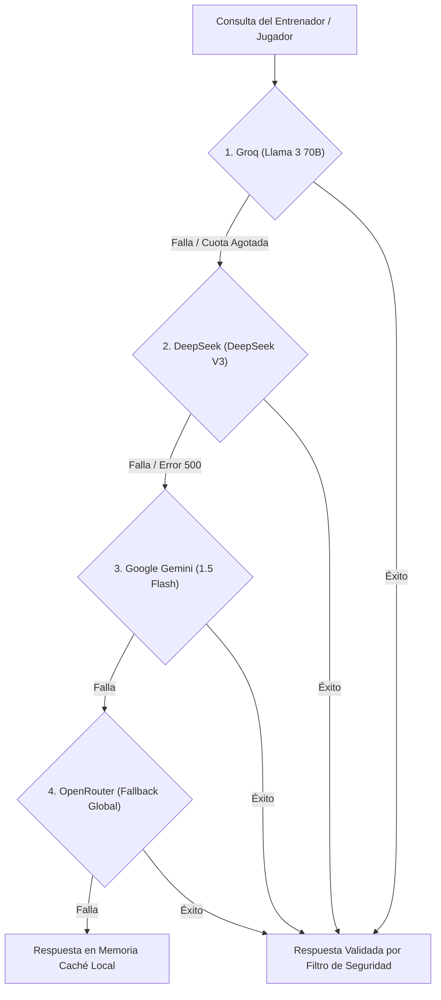

# 10 — Entrenamientos, Training Hub y Coach IA Asesor

Volver a: [[00_INDICE_MAESTRO]] | Anterior: [[09_TRIBUNAL_DE_DISCIPLINA]] | Siguiente: [[11_TESTING_Y_CALIDAD]]

---

## 1. Centro de Entrenamiento (Training Hub)

El módulo [`TrainingHub/index.jsx`](file:///C:/Users/KennentDVA/Documents/Proyectos_Code/Rugby%20Orcos/src/components/TrainingHub/index.jsx) organiza las sesiones técnicas y físicas del club:

* **Biblioteca de Ejercicios:** Descompuestos por destreza (Tackle seguro, Ruck cleanout, Maul, Lineout, Pases en velocidad, Patada de despeje).
* **Control de Cargas:** Cálculo de la carga semanal del equipo (`Volumen = Duración (min) x Intensidad RPE`).

---

## 2. Asistente Táctico: Coach IA Multi-Provider

El club dispone de un asistente táctico integrado en [`AIChat.jsx`](file:///C:/Users/KennentDVA/Documents/Proyectos_Code/Rugby%20Orcos/src/components/AIChat.jsx) con un motor de contingencia de 4 niveles ([`multiProviderCoach.js`](file:///C:/Users/KennentDVA/Documents/Proyectos_Code/Rugby%20Orcos/src/engine/multiProviderCoach.js)):

### Prompt Engineering y Contexto del Club (`promptBuilder.js`)
El motor inyecta automáticamente en el contexto del modelo:
* El glosario de términos del club (Orcos Negros, Makgora, Pack de Forwards, In-Goal).
* La plantilla activa y las lesiones actuales para sugerir rotaciones realistas.
* El perfil del próximo rival según el calendario.

---

## 3. Filtro de Contenido y Guardrails de Seguridad (`contentFilter.js`)

Para asegurar un entorno seguro y deportivo:
* El motor escanea tanto las consultas como las respuestas generadas.
* Bloquea contenido ofensivo, consejos médicos imprudentes o incitaciones al dopaje.
* Si se detecta una consulta sobre conmociones o traumatismos graves, el sistema interrumpe la respuesta con una advertencia roja: *"Consulte inmediatamente a un médico profesional y aplique el protocolo HIA"*.

Ver siguiente: [[11_TESTING_Y_CALIDAD]]
