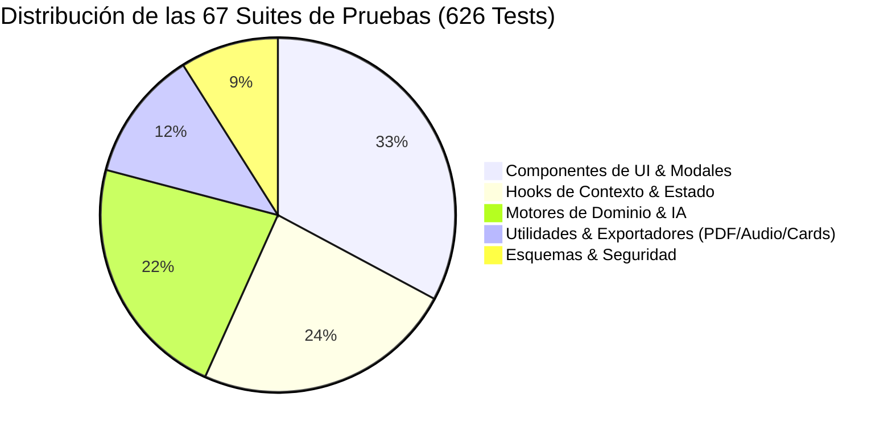
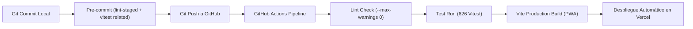

# 11 — Estrategia de Testing, Calidad y CI/CD

Volver a: [[00_INDICE_MAESTRO]] | Anterior: [[10_COACH_IA_Y_ENTRENAMIENTOS]]

---

## 1. Pirámide de Pruebas Automatizadas

El proyecto cuenta con una cobertura integral garantizada por **Vitest**:



### Estadísticas de Ejecución
* **Total de Suites:** 67 archivos de pruebas.
* **Total de Tests:** 626 tests unitarios y de integración.
* **Entorno de Simulación:** Happy-DOM ultraliviano para aislamiento en memoria.
* **Tiempo Medio de Ejecución:** ~34 segundos en local.

---

## 2. Política de Cero Advertencias en Linter (`--max-warnings 0`)

La regla operativa del club prohíbe subir código con advertencias o variables huérfanas:

```bash
# Comando ejecutado en pre-commit y CI
npm run lint
# Equivalente a: eslint . --ext js,jsx --report-unused-disable-directives --max-warnings 0
```

Cualquier advertencia de ESLint detiene inmediatamente el pipeline y bloquea la confirmación de Git (Git Stash pre-commit hook).

---

## 3. Pruebas de Regresión y Casos Límite Clave

1. **`attributeCalculator.test.js`**:
   - Conversión de alturas en cm vs m sin desbordar el cálculo.
   - Normalización de posiciones acentuadas (`'Segunda Línea'`).
   - Mapeo de alias anglosajones (`'Hooker'`, `'Scrum-half'`).
2. **`exportPlayerCard.test.js` & `exportMatchBanner.test.js`**:
   - Verificación de composición en HTML5 Canvas con dimensiones correctas (1200x1200px y 1200x675px).
3. **`rugbyAudio.test.js`**:
   - Prueba de inicialización del `AudioContext` sin bloqueos de reproducción automática.
4. **`exportCalendarIcs.test.js`**:
   - Verificación de la estructura RFC 5545 (`BEGIN:VCALENDAR`, `DTSTART`, `SUMMARY`, `END:VEVENT`).

---

## 4. Pipeline de Integración Continua (CI/CD)



---

## 5. Respaldo y Restauración de Datos (Disaster Recovery)

El sistema incluye en [`useDataIO.js`](file:///C:/Users/KennentDVA/Documents/Proyectos_Code/Rugby%20Orcos/src/context/hooks/useDataIO.js) un mecanismo de exportación e importación integral en JSON:
* Respaldos de contingencia v5.0 que incluyen `players`, `matches`, `finances`, `loans`, `customTactics` y configuraciones locales.
* Validación de integridad antes de restaurar para evitar la corrupción de la base de datos.
